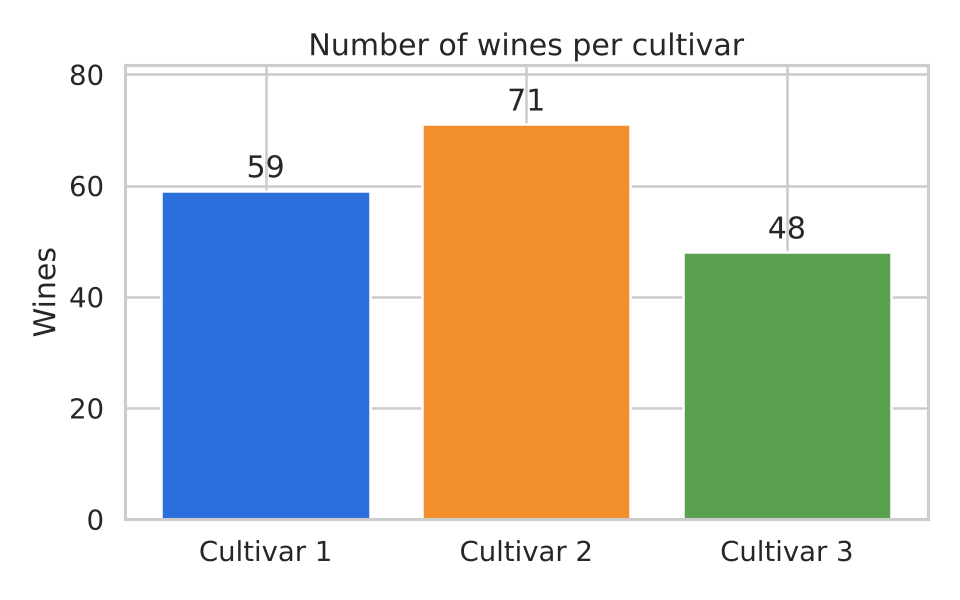
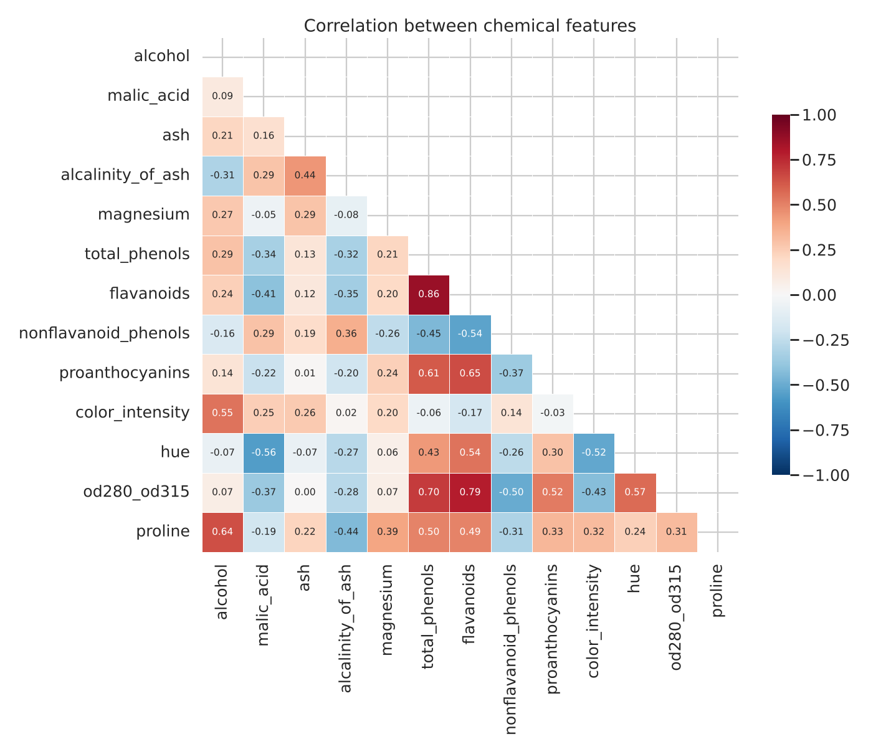
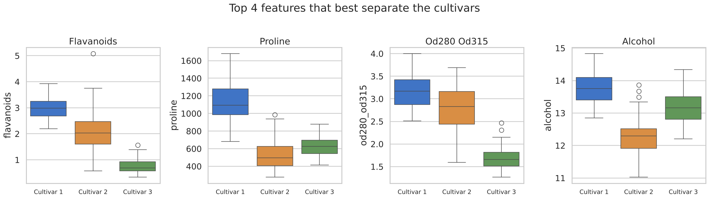
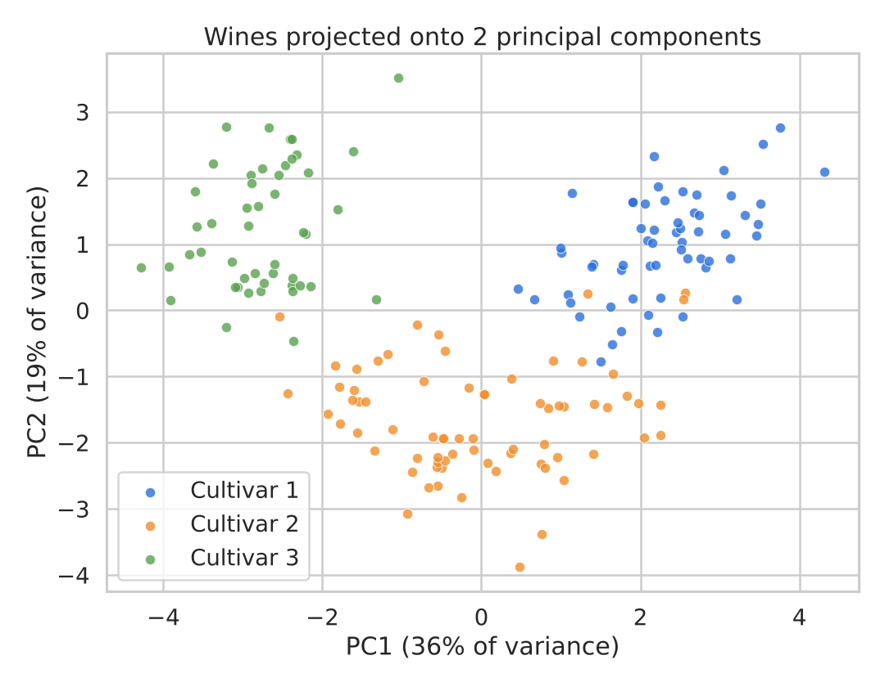
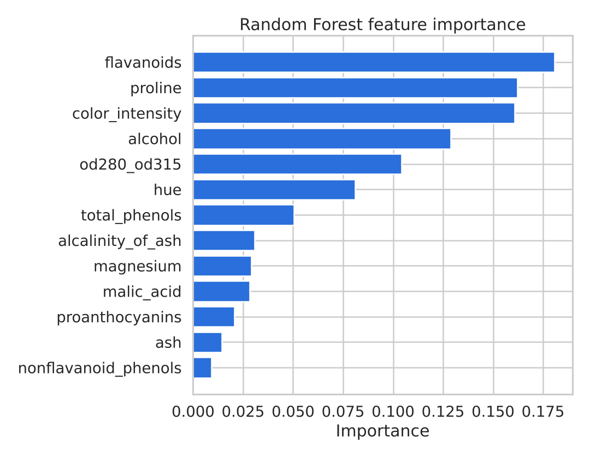

# 🍷 Wine Data Analysis

Exploratory data analysis of the **UCI Wine dataset**: 178 wines from three grape cultivars grown in the same region of Italy, each described by 13 chemical measurements.

**Goal:** find out which chemical properties tell the three cultivars apart, and check how well a simple model can identify a wine's cultivar from its chemistry.

**Tools:** Python · pandas · matplotlib · seaborn · scikit-learn

---

## 📌 Key findings

| # | Finding |
|---|---|
| 1 | The data is clean: **178 rows, 13 features, 0 missing values, 0 duplicates**. Classes are fairly balanced (59 / 71 / 48). |
| 2 | **Flavanoids, proline, OD280/OD315 and alcohol** separate the cultivars best. |
| 3 | **Cultivar 1** has by far the most proline (avg ≈ 1,116 vs 520–630) and the highest alcohol (≈ 13.7%). |
| 4 | **Cultivar 3** has very low flavanoids (avg ≈ 0.78 vs 2.08–2.98) and low OD280/OD315. |
| 5 | Flavanoids and total phenols are strongly correlated (**r = 0.86**), so they carry overlapping information. |
| 6 | Just **2 principal components (55% of variance)** already show three clearly visible groups. |
| 7 | A Random Forest identifies the cultivar with **96.7% accuracy** (5-fold cross-validation, ± 2.1%). |

---

## 📊 Charts

### 1. Class balance


### 2. Correlation between features


### 3. Features that best separate the cultivars


| Cultivar | Flavanoids | Proline | OD280/OD315 | Alcohol |
|---|---|---|---|---|
| Cultivar 1 | 2.98 | 1115.71 | 3.16 | 13.74 |
| Cultivar 2 | 2.08 | 519.51 | 2.79 | 12.28 |
| Cultivar 3 | 0.78 | 629.90 | 1.68 | 13.15 |

### 4. PCA – wines in 2 dimensions


### 5. Feature importance (Random Forest)


---

## 🗂️ Project structure

```
wine-data-analysis/
├── analysis.py          # full analysis script
├── data/wine.csv        # dataset exported to CSV
├── images/              # generated charts
├── results.json         # computed metrics
└── requirements.txt
```

## ▶️ How to run

```bash
pip install -r requirements.txt
python analysis.py
```

The script rebuilds `data/wine.csv`, every chart in `images/` and `results.json`.

## 🔬 Method

1. **Data quality check** – missing values, duplicates, class counts.
2. **Correlation analysis** – Pearson correlation between all 13 features.
3. **Feature separation** – ranks features by the ratio of between-cultivar to within-cultivar variance (ANOVA F-ratio).
4. **PCA** – standardises the features and projects them onto 2 components.
5. **Classification** – Random Forest (300 trees) on standardised features, evaluated with 5-fold cross-validation.

## 📚 Dataset

Forina, M. et al. *Wine Data Set.* UCI Machine Learning Repository. Loaded through `sklearn.datasets.load_wine`.

---

👤 **Lê Thanh Truyền** – IT student @ UIT – VNU-HCM
